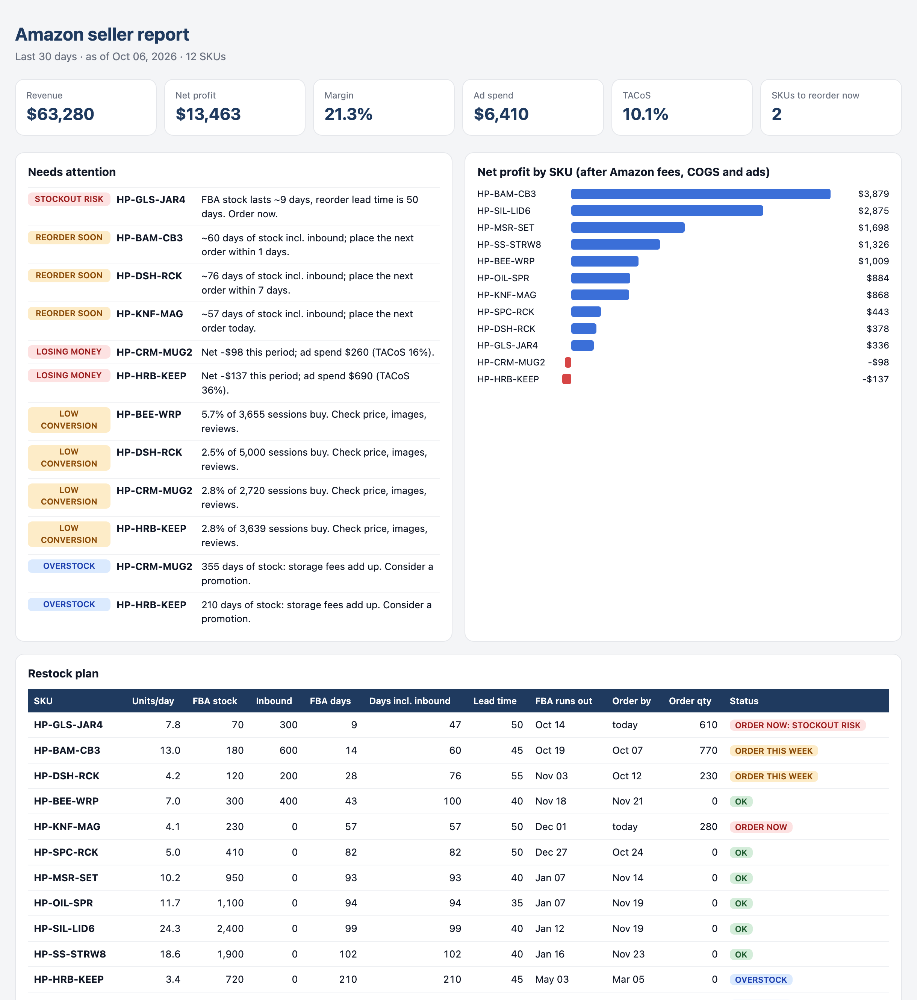

# Amazon seller report: real profit, restock plan, red flags

Seller Central tells you sales. It doesn't tell you which SKUs actually make money
after referral fees, FBA fees, product cost, freight and ads, or which one is about
to run out while the next shipment is still on the water.

This tool takes the standard Seller Central downloads and builds:

- **Profit by SKU**: revenue, Amazon fees, COGS, PPC, net profit, margin, ACoS,
  TACoS, conversion. Every result is an Excel formula, so changing a cost
  recalculates everything.
- **Restock plan**: daily velocity, days of cover in FBA and including inbound,
  the date FBA runs out, the date to place the next order given your supplier lead
  time, and how much to order. One status rule (ORDER NOW / this week / low FBA /
  overstock / OK) is used everywhere.
- **Needs attention**: a plain-language list: stockout risks, SKUs losing money,
  listings with poor conversion, overstock that is burning storage fees.
- **HTML summary**: the same numbers on one page, for email or a phone.



## Inputs

| File | Where it comes from |
|---|---|
| `BusinessReport-ByChildASIN.csv` | Reports → Business Reports → Detail Page Sales and Traffic by Child Item |
| `FBA_Inventory.csv` | Reports → Fulfillment → Inventory |
| `SponsoredProducts_AdvertisedProduct.csv` | Advertising → Reports → Sponsored Products → Advertised product |
| `product_costs.csv` | The seller's own sheet: unit cost, freight per unit, FBA fee, referral %, lead time |

Column names are mapped in one place at the top of `report.py`, so a renamed
Seller Central column is a one-line fix. A SKU without a cost row is reported, never silently dropped.

## Run

```bash
pip install openpyxl pytest
python make_sample_data.py                    # fictional brand, 12 SKUs
python report.py --days 30 --as-of 2026-10-06 # -> Amazon_Seller_Report.xlsx
python html_summary.py --as-of 2026-10-06     # -> Amazon_Seller_Summary.html
pytest
```

Yellow cells (costs, lead times, safety stock, thresholds on the Settings sheet) are inputs.

## Going further

- Pull the reports automatically with the **Amazon SP-API** instead of downloading CSVs
- Competitor prices and BSR history through the **Keepa API** (not by scraping Amazon,
  which breaks their terms)
- Schedule it weekly and send the HTML summary by email or Telegram

All products and numbers in `sample_data/` are fictional.
